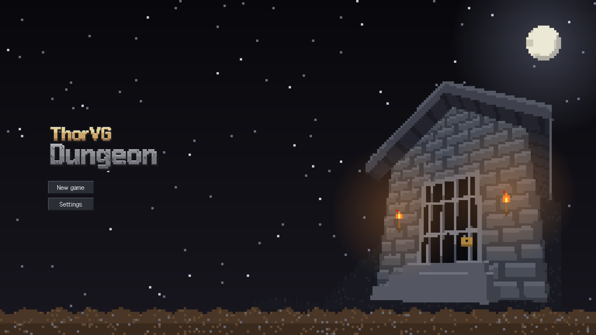
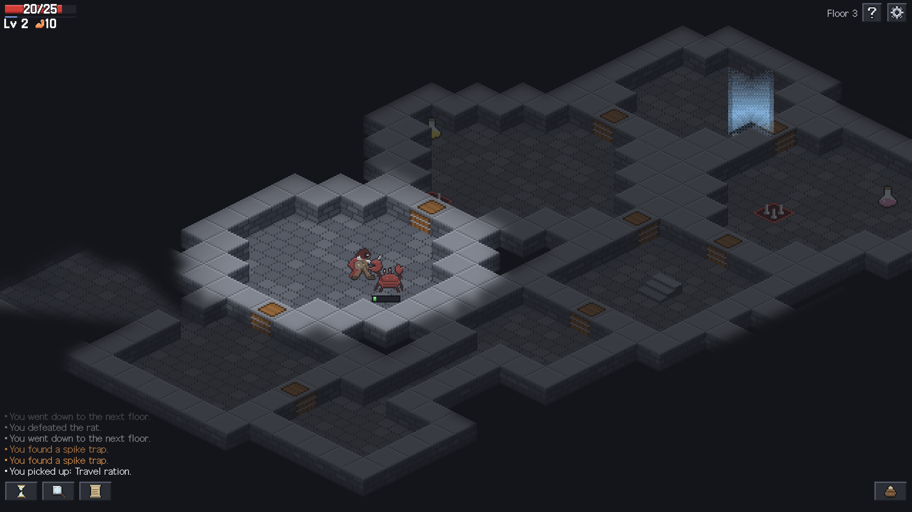
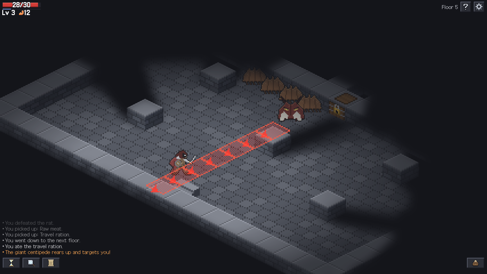
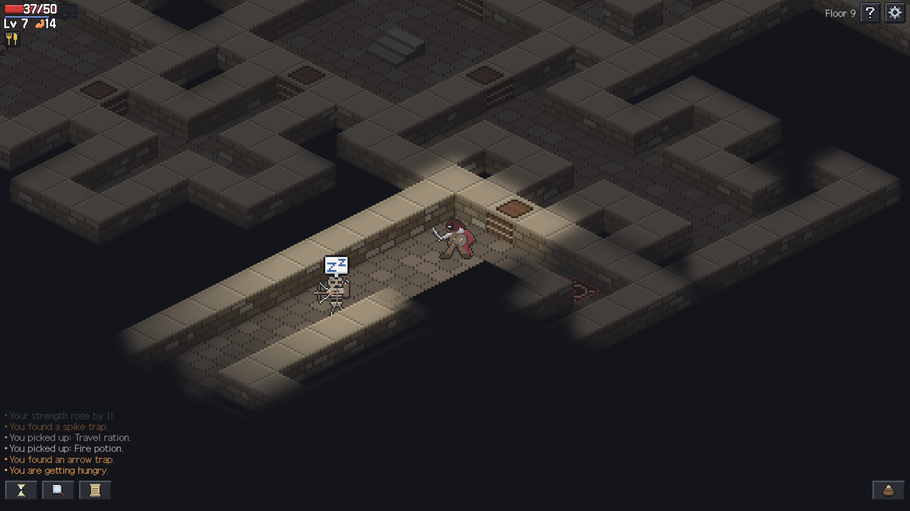
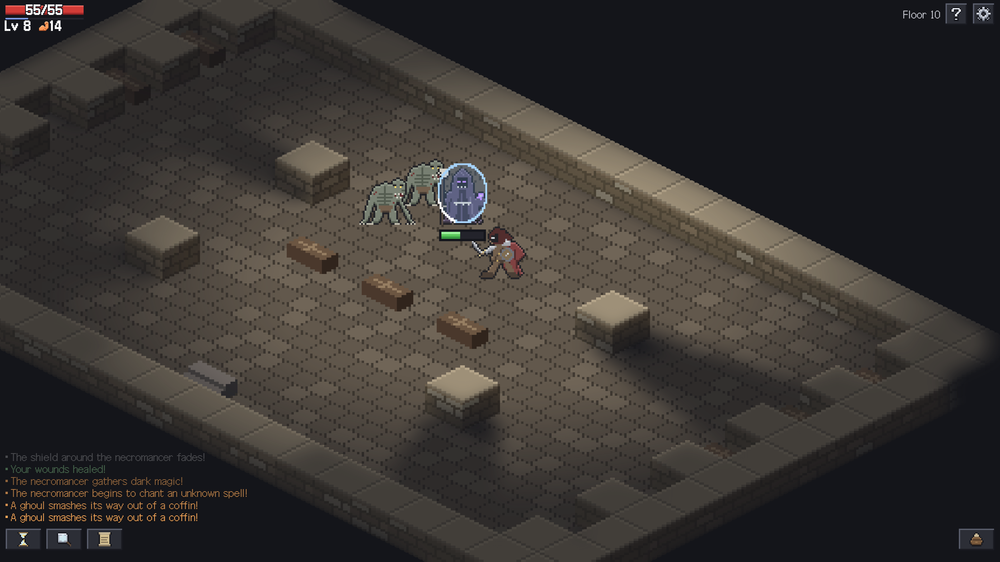

# ThorVG Dungeon

[English](README.md) | 한국어



**[브라우저에서 플레이하기](https://ossca-thorvg.github.io/GameJam-ThorVG-Dungeon/)**

## 소개

ThorVG Dungeon은 [OSSCA ThorVG 게임잼](https://ossca-thorvg.github.io/site/project/#event)을 위해 만든 웹 턴제 로그라이크입니다. 하수도와 지하 묘지, 두 스테이지에 걸친 열 개의 층을 내려가게 됩니다. 5층에는 거대 지네가, 10층에는 네크로맨서가 보스로 존재하며, 네크로맨서를 쓰러뜨리는 것이 게임의 목표입니다.

감정하기 전에는 알 수 없는 11종의 물약, 바닥에 숨은 함정, 다양한 기믹을 가진 적 등 여러 재미 요소를 넣었습니다.

게임 화면의 그래픽은 모두 [ThorVG](https://github.com/thorvg/thorvg)의 WebCanvas 패키지로, WebGL 렌더러를 써서 그립니다. 메뉴, 대화창, 상태 효과 막대는 HTML이고, 체력 막대와 경험치 막대는 ThorVG로 그립니다. 게임은 영어와 한국어로 즐길 수 있고, 설정에서 바꿀 수 있습니다.

## 조작법

별도의 단축키 없이 마우스 또는 터치로 플레이합니다. 타일을 클릭함으로써 이동/공격/아이템 습득/상호작용 등이 가능하며, 제자리에서 대기하거나 주변을 탐색하거나 가방을 여는 등의 동작은 마우스를 통해 이루어집니다.

플레이 중 특정 정보가 필요한 상황이 되면 그 상황에 대한 튜토리얼이 최초 1회 표시되며, 우측 상단의 도움말 버튼으로 다시 열람할 수 있습니다.

## 스크린샷

| | |
| --- | --- |
|  |  |
|  |  |

## 사용한 ThorVG 기능

| 기능 | 게임에서 쓰인 곳 |
| --- | --- |
| `LottieAnimation` | 타이틀 화면 전에 재생되는 ThorVG 스플래시 ([`src/splash.ts`](src/splash.ts)) |
| `Scene`, `Shape` | 모든 타일, 아이템, 캐릭터, 효과는 이미지 파일 없이 색칠한 사각형으로 만든 픽셀 아트입니다. 같은 색이 이어진 픽셀 하나가 `Shape` 하나이고, 그림 한 장이 그 `Shape`들의 `Scene`입니다 ([`src/pixelSprite.ts`](src/pixelSprite.ts), [`src/tileArt.ts`](src/tileArt.ts), [`src/characterArt.ts`](src/characterArt.ts)) |
| `mask`, `MaskMethod.InvLuma`·`Alpha`·`InvAlpha` | 층을 덮는 어둠. 지금 보이는 곳과 기억하는 곳을 담은 흑백 light map이 어둠에 구멍을 내고, 벽에 닿은 빛은 벽에만 머물며, 벽과 문이 그 뒤를 가립니다 ([`src/render.ts`](src/render.ts)) |
| `gaussianBlur` | 빛의 가장자리를 부드럽게 만듭니다 ([`src/render.ts`](src/render.ts)) |
| `tint`, `gaussianBlur` | 죽으면 세상이 회색으로 바래며 흐려집니다 ([`src/main.ts`](src/main.ts)) |
| `fillEffect` | 주인공은 맞으면 붉게, 적은 맞으면 하얗게 번쩍입니다 ([`src/main.ts`](src/main.ts)) |
| `RadialGradient` | 타이틀 화면의 달빛과 횃불의 빛, 주인공 주위의 빛 ([`src/menuArt.ts`](src/menuArt.ts), [`src/render.ts`](src/render.ts)) |
| `LinearGradient`, SVG `Picture` | 타이틀 화면의 밤하늘, 달, 불꽃 등 ([`src/menuArt.ts`](src/menuArt.ts)) |
| `Text`, `Font.load` | HUD의 체력·레벨 글자(글자 사본을 겹쳐 만든 테두리 포함)와 떠오르는 피해 숫자. 글꼴은 Galmuri ([`src/hud.ts`](src/hud.ts), [`src/render.ts`](src/render.ts), [`src/fonts.ts`](src/fonts.ts)) |
| `translate`, `scale`, `rotate`, `opacity` | 카메라와 확대·축소, 공격의 돌진과 밀려남, 지네가 돌진할 줄에 놓이는 화살표, 사라지는 효과 ([`src/attackEffect.ts`](src/attackEffect.ts), [`src/laneWarning.ts`](src/laneWarning.ts)) |

## 팀

- [@alpakaDurumi](https://github.com/alpakaDurumi): 혼자 개발. 게임 기획, 코드, 아트와 사운드의 방향.

## Credits

| 에셋 | 제작자 | 출처 | 라이선스 | 변경 |
| --- | --- | --- | --- | --- |
| ThorVG 스플래시 | ThorVG 프로젝트 | [OSSCA ThorVG GameJam](https://ossca-thorvg.github.io/site/project/#event) | [약관](LICENSES/LicenseRef-ThorVG-Splash.txt) | 없음, 제공된 파일을 그대로 사용 |
| Galmuri 글꼴 (Galmuri9, Galmuri11, Galmuri11 Bold) | Lee Minseo (quiple) | [GitHub](https://github.com/quiple/galmuri) | [OFL 1.1](LICENSES/OFL-1.1.txt) | 없음, woff2와 ttf 파일을 제공된 그대로 사용 |

### 참고한 게임

알고리즘과 수치를 참고하기 위해 아래 게임들을 보았습니다. 코드는 복사하지 않았습니다.

- [Brogue CE](https://github.com/tmewett/BrogueCE) (AGPL-3.0): 방 이어 붙이기, 순환 통로, 방 모양 생성
- [Shattered Pixel Dungeon](https://github.com/00-Evan/shattered-pixel-dungeon) (GPL-3.0): 걷는 속도, 카메라 따라가기, 화면 흔들림, 길 찾기, 떠오르는 피해 숫자, 시야 거리, 시야를 막는 문, 적 행동 구조
- [Dungeon Crawl Stone Soup](https://github.com/crawl/crawl): 방 템플릿 형식과 무작위 타일

시야와 빛의 모양은 Nicky Case의 [Sight & Light](https://ncase.me/sight-and-light/) 방식을 씁니다.

## 사운드

효과음과 음악은 코드로 만들었습니다. 녹음이나 샘플이 아니며, 외부 오디오는 쓰지 않았습니다.

- [`assets/sound`](assets/sound)에 Ogg Vorbis 파일로 들어 있습니다. 합성 스크립트가 시드 난수로 WAV 파일을 렌더링했고, ffmpeg의 libvorbis로 WAV 파일을 Ogg로 인코딩했습니다. 스크립트는 이 저장소에 포함되어 있지 않습니다.
- 악보는 이 게임을 위해 썼으며, 기존 곡을 옮겨 적은 것이 아닙니다.
- 합성 스크립트는 Claude Code(Anthropic)로 작성했습니다. 개발자가 각 소리를 직접 들어 보고 고르고, 바꿀 방향을 지시했습니다.

이 사운드는 개발자가 고르고 방향을 정했으며, 코드와 같은 [MIT](LICENSE) 라이선스로 배포합니다.

## 아트

맵 타일, 아이템, 오브젝트, 캐릭터, 인터페이스, 효과의 픽셀 아트는 코드로 만들었습니다. 기존 이미지를 보고 그리거나 따라 그린 것이 아니며, 외부 아트는 쓰지 않았습니다.

- [`src/tileArt.ts`](src/tileArt.ts)는 층을 만들 때 각 스테이지의 바닥, 벽, 물, 문, 계단을 판석, 벽돌, 물결의 규칙으로 픽셀 단위로 그립니다. 함정과 관도 같은 방식으로 그리고, [`src/effectArt.ts`](src/effectArt.ts)는 효과를 그립니다. 불, 가스, 서리처럼 바닥을 덮는 것은 노이즈와 디더링으로, 계단 위의 빛, 고리, 불똥, 화살은 그 모양으로 그립니다.
- [`src/itemArt.ts`](src/itemArt.ts)는 아이템, 상자, 모닥불, 표지판을 픽셀 행으로 담고, [`src/characterArt.ts`](src/characterArt.ts)는 주인공과 적을, [`src/uiArt.ts`](src/uiArt.ts)는 인터페이스의 아이콘과 틀을 같은 방식으로 담습니다. 이 저장소 밖의 스크립트가 선과 도형으로 그린 뒤 그 행들을 출력했습니다.
- 코드는 Claude Code(Anthropic)로 작성했습니다. 개발자가 초안 시트에서 모양을 고르고, 바꿀 방향을 지시했습니다.

이 아트는 개발자가 고르고 방향을 정했으며, 코드와 같은 [MIT](LICENSE) 라이선스로 배포합니다.

## 개발

Vite의 요구 사항에 따라 [Node.js](https://nodejs.org/) 20.19 이상(22 버전대는 22.12 이상)과 WebGL을 지원하는 브라우저가 필요합니다.

```sh
npm install
npm run dev
```

## 라이선스

코드는 [MIT](LICENSE) 라이선스입니다. `assets/`의 에셋은 [Credits](#credits)에 적힌 라이선스를 따릅니다. `assets/sound`의 사운드는 [사운드](#사운드)에서 다룹니다.
