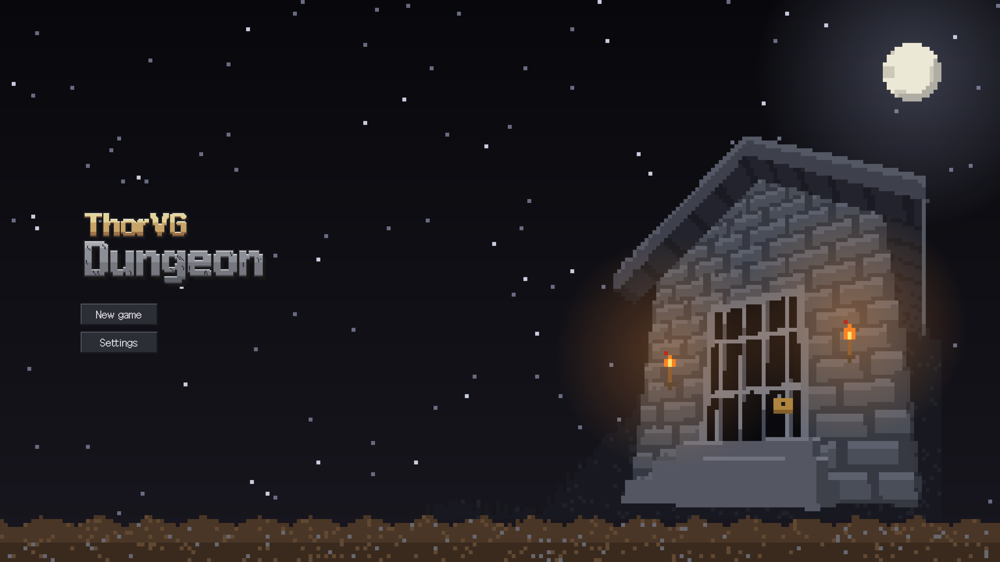
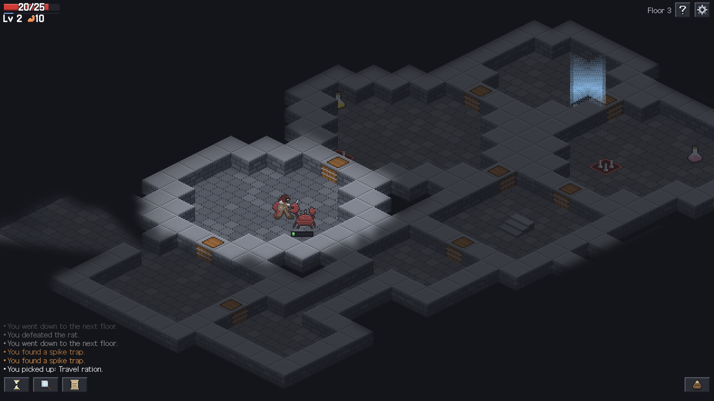
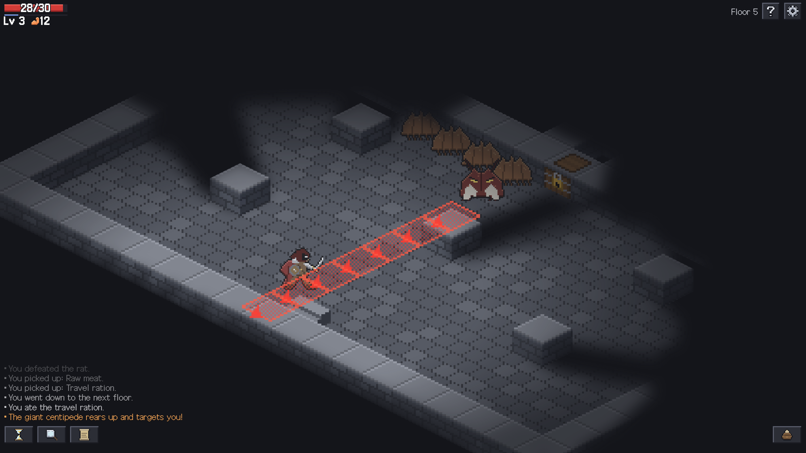
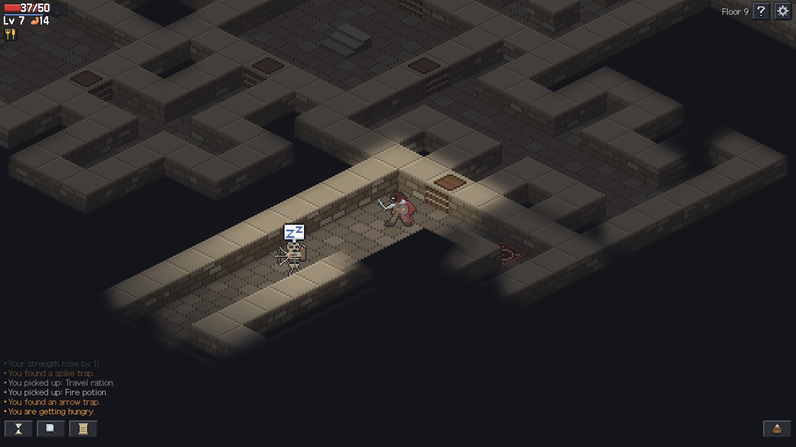
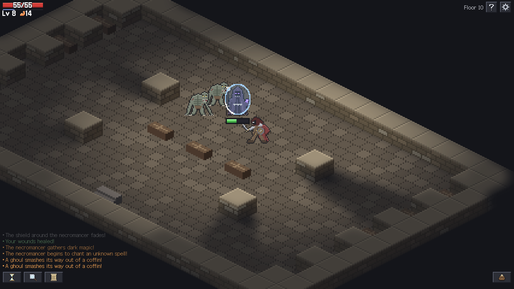

# ThorVG Dungeon

English | [한국어](README.ko.md)



**[Play in the browser](https://ossca-thorvg.github.io/GameJam-ThorVG-Dungeon/)**

## About

ThorVG Dungeon is a turn-based roguelike for the web, made for the [OSSCA ThorVG GameJam](https://ossca-thorvg.github.io/site/project/#event). You go down ten floors in two stages, a sewer and a catacomb. A giant centipede is the boss of floor 5 and a necromancer is the boss of floor 10, and the goal of the game is to defeat the necromancer.

It has many things that make it fun: 11 kinds of potions that you cannot know before you identify them, traps hidden in the floor, and enemies with a variety of gimmicks.

All the graphics of the game screen are drawn by [ThorVG](https://github.com/thorvg/thorvg) through its WebCanvas package, with the WebGL renderer. The menus, dialogs and the bar of status effects are HTML, while the health bar and the experience bar are drawn by ThorVG too. The game is playable in English and Korean, which you can change in the settings.

## Controls

The game is played with the mouse or by touch, with no separate hotkeys. Clicking a tile lets you move, attack, pick up an item, interact, and more. Actions such as waiting where you stand, searching the area around you, or opening the bag are also done with the mouse.

When you reach a situation in which you need particular information, a tutorial for it is shown once, the first time. You can read it again with the help button at the top right.

## Screenshots

| | |
| --- | --- |
|  |  |
|  |  |

## ThorVG Features

| Feature | Where it is used in the game |
| --- | --- |
| `LottieAnimation` | The ThorVG splash that plays before the title screen ([`src/splash.ts`](src/splash.ts)) |
| `Scene` and `Shape` | Every tile, item, character and effect is pixel art made of colored rectangles, with no image files. A run of pixels of one color is one `Shape`, and a picture is a `Scene` of them ([`src/pixelSprite.ts`](src/pixelSprite.ts), [`src/tileArt.ts`](src/tileArt.ts), [`src/characterArt.ts`](src/characterArt.ts)) |
| `mask` with `MaskMethod.InvLuma`, `Alpha` and `InvAlpha` | The dark that covers a floor. A grayscale light map of what you see and what you remember cuts a hole in it, light on a wall stays on the wall, and walls and doors hide what is behind them ([`src/render.ts`](src/render.ts)) |
| `gaussianBlur` | The edge of the light is blurred to be soft ([`src/render.ts`](src/render.ts)) |
| `tint` and `gaussianBlur` | When you die, the world fades to gray and blurs ([`src/main.ts`](src/main.ts)) |
| `fillEffect` | The hero flashes red when hit, and an enemy flashes white ([`src/main.ts`](src/main.ts)) |
| `RadialGradient` | The glow of the moon and the torches on the title screen, and the light around the hero ([`src/menuArt.ts`](src/menuArt.ts), [`src/render.ts`](src/render.ts)) |
| `LinearGradient` and SVG `Picture` | The night sky, the moon, the flames and more on the title screen ([`src/menuArt.ts`](src/menuArt.ts)) |
| `Text` and `Font.load` | The health and level text of the HUD, with an outline made of copies of the text, and the floating damage numbers, in the Galmuri font ([`src/hud.ts`](src/hud.ts), [`src/render.ts`](src/render.ts), [`src/fonts.ts`](src/fonts.ts)) |
| `translate`, `scale`, `rotate`, `opacity` | Camera and zoom, the lunge and knockback of an attack, the arrows along the line a centipede is about to charge down, and fading effects ([`src/attackEffect.ts`](src/attackEffect.ts), [`src/laneWarning.ts`](src/laneWarning.ts)) |

## Team

- [@alpakaDurumi](https://github.com/alpakaDurumi): solo developer. Game design, code, and the direction of the art and sound.

## Credits

| Asset | Author | Source | License | Changes |
| --- | --- | --- | --- | --- |
| ThorVG splash | ThorVG project | [OSSCA ThorVG GameJam](https://ossca-thorvg.github.io/site/project/#event) | [Terms](LICENSES/LicenseRef-ThorVG-Splash.txt) | None, the file is used as provided |
| Galmuri fonts (Galmuri9, Galmuri11, Galmuri11 Bold) | Lee Minseo (quiple) | [GitHub](https://github.com/quiple/galmuri) | [OFL 1.1](LICENSES/OFL-1.1.txt) | None, the woff2 and ttf files are used as provided |

### References

These games were used as references for algorithms and numeric values. Their code was not copied.

- [Brogue CE](https://github.com/tmewett/BrogueCE) (AGPL-3.0): room attachment, loops, and room shape generation
- [Shattered Pixel Dungeon](https://github.com/00-Evan/shattered-pixel-dungeon) (GPL-3.0): walking speed, camera follow, screen shake, pathfinding, floating damage numbers, view distance, doors blocking the view, and enemy behavior structure
- [Dungeon Crawl Stone Soup](https://github.com/crawl/crawl): room template format and random tiles

The field of view and the shape of the light use the method from [Sight & Light](https://ncase.me/sight-and-light/) by Nicky Case.

## Sound

The sound effects and music are made by code. They are not recordings or samples, and no outside audio is used in them.

- [`assets/sound`](assets/sound) holds the sounds as Ogg Vorbis files. A synthesizer script rendered them as WAV files with seeded random numbers, and ffmpeg with libvorbis encoded the WAV files to Ogg. The script is not part of this repository.
- The scores were written for this game, not transcribed from an existing piece.
- The synthesizer script was written with Claude Code (Anthropic). The developer chose each sound by listening and gave the directions to change it.

The developer chose and directed these sounds, and releases them under the [MIT](LICENSE) license like the code.

## Art

The pixel art of the map tiles, items, objects, characters, interface and effects is made by code. It is not drawn from or traced over existing images, and no outside art is used in it.

- [`src/tileArt.ts`](src/tileArt.ts) draws the floor, walls, water, doors and stairs of each stage pixel by pixel when a floor is built, from rules for flagstones, bricks and ripples. It draws the traps and coffins the same way, and [`src/effectArt.ts`](src/effectArt.ts) draws the effects: fire, gas, frost and the other things that cover a floor from noise and dithering, and the light over the stairs, the rings, the sparks and the arrows from their shapes.
- [`src/itemArt.ts`](src/itemArt.ts) holds the items, the chest, the campfire and the signs as rows of pixels, and [`src/characterArt.ts`](src/characterArt.ts) holds the hero and the enemies the same way, as [`src/uiArt.ts`](src/uiArt.ts) holds the icons and frames of the interface. A script outside this repository drew them from lines and shapes and wrote out the rows.
- The code was written with Claude Code (Anthropic). The developer chose the look from sheets of drafts and gave the directions to change it.

The developer chose and directed this art, and releases it under the [MIT](LICENSE) license like the code.

## Development

Requires [Node.js](https://nodejs.org/) 20.19 or later (22.12 or later on the 22 line), as Vite does, and a browser with WebGL.

```sh
npm install
npm run dev
```

## License

The code is licensed under [MIT](LICENSE). The assets in `assets/` have the licenses listed in [Credits](#credits). The sounds in `assets/sound` are covered in [Sound](#sound).
